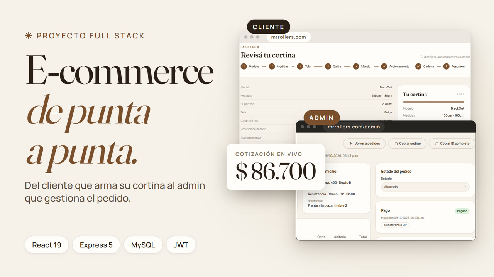
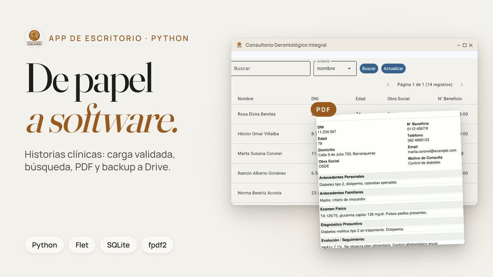
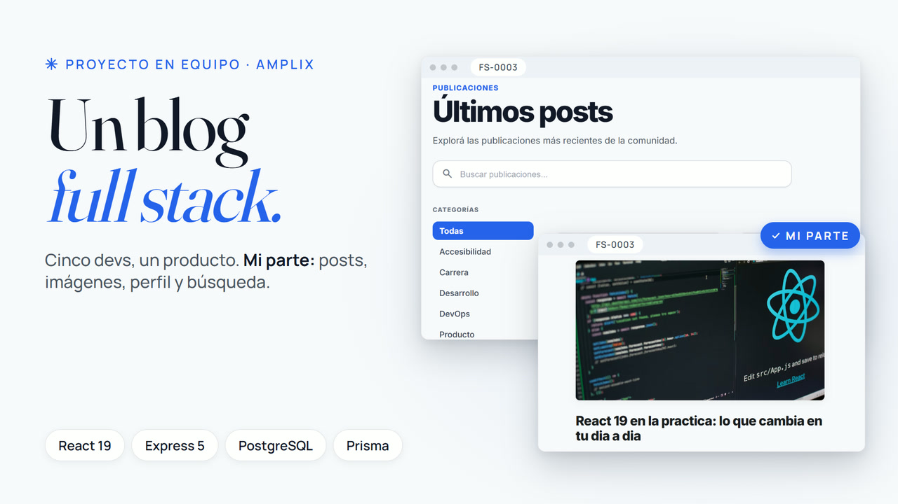

  
  
  

## Sobre mí

Soy Marcos, desarrollador fullstack de Argentina. Me recibí de Técnico Universitario en Programación en la UTN y hoy curso la Licenciatura en Sistemas.

Trabajo sobre todo con React y TypeScript en el frontend y con Node.js y Express en el backend. Hice e-commerce, APIs y paneles de administración para clientes reales, y un blog en equipo de cinco personas dentro del Amplix Acceleration Program. Me importa que el código quede ordenado y con tests.

Estoy disponible para proyectos freelance y abierto a oportunidades fullstack.

## Proyectos

<table>
  <tr>
    <td width="33%" valign="top">
      
      <h3><a href="https://mrrollers.com/">MarketHub</a></h3>
      
E-commerce en producción con carrito, checkout, gestión de pedidos, envíos dinámicos y panel de administración.

      
    </td>
    <td width="33%" valign="top">
      
      <h3><a href="https://github.com/MarcosAVZ/Consultorio">Consultorio Gerontológico</a></h3>
      
App de escritorio para historias clínicas. Búsqueda por DNI, exportación a PDF y backup en Google Drive.

      
    </td>
    <td width="33%" valign="top">
      
      <h3><a href="https://github.com/amplixme/FS-0003">FS-0003 Blog</a></h3>
      
Blog hecho en equipo, con roles de usuario y administrador, comentarios, perfiles públicos y panel de estadísticas.

      
    </td>
  </tr>
</table>

Las demos en video están en el [portfolio](https://portfolio-phi-beryl-9c2nkdpq69.vercel.app/#projects).

## Stack

<table>
  <tr>
    <td><b>Frontend</b></td>
    <td></td>
  </tr>
  <tr>
    <td><b>Backend</b></td>
    <td></td>
  </tr>
  <tr>
    <td><b>Bases de datos</b></td>
    <td></td>
  </tr>
  <tr>
    <td><b>Testing y herramientas</b></td>
    <td></td>
  </tr>
</table>

## Actividad

  <picture>
    <source media="(prefers-color-scheme: dark)" srcset="https://streak-stats.demolab.com?user=MarcosAVZ&locale=es&hide_border=true&background=0D1117&ring=FAFAFA&fire=FAFAFA&currStreakLabel=FAFAFA&sideLabels=A1A1A1&currStreakNum=FAFAFA&sideNums=FAFAFA&dates=6E7681&stroke=30363D" />
    
  </picture>

<picture>
  <source media="(prefers-color-scheme: dark)" srcset="https://raw.githubusercontent.com/MarcosAVZ/MarcosAVZ/output/github-snake-dark.svg" />
  
</picture>
